# Pomodoro

运行在 Waveshare ESP32-C6-Touch-AMOLED-2.16 上的离线番茄钟。

它不用联网。时间、设置、当前计时和统计都保存在设备中。固件在电脑上构建，通过 USB-C 烧录和调试。

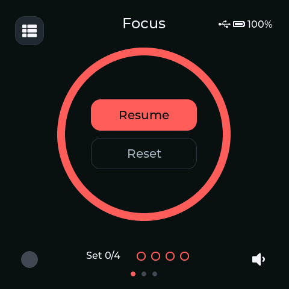

上图由设备上的当前固件直接导出。真机使用 480×480 AMOLED 触摸屏，界面为英文。

## 界面

下面的图片由当前固件在实机上绘制，再通过 USB 截图命令导出。Statistics 中的数字是截图用示例，不是用户数据。

| Focus Ready                             | Focus Running                               | Focus Paused                              |
| --------------------------------------- | ------------------------------------------- | ----------------------------------------- |
| 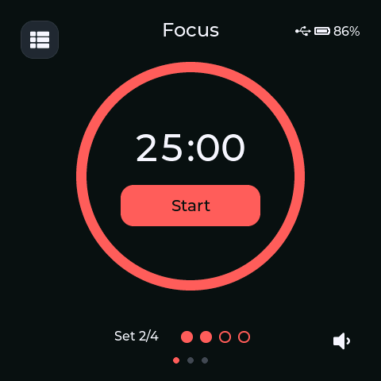 | 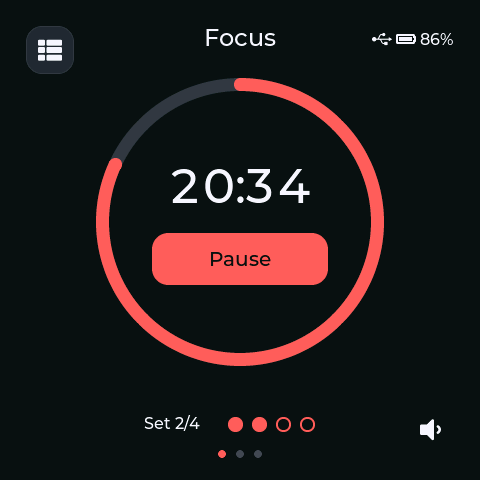 | 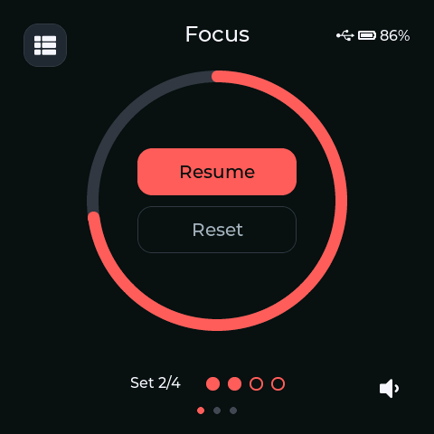 |

| Short break                             | Long break                            | Focus complete                                |
| --------------------------------------- | ------------------------------------- | --------------------------------------------- |
| 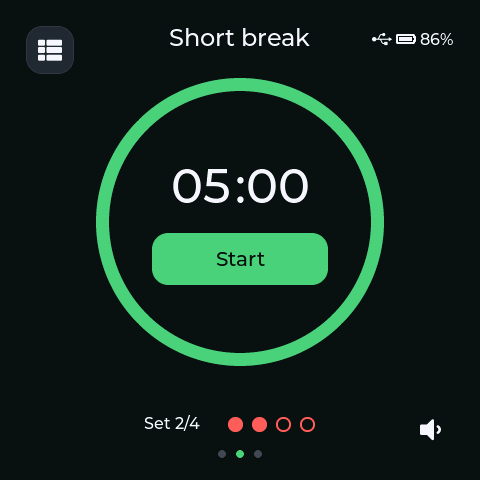 | 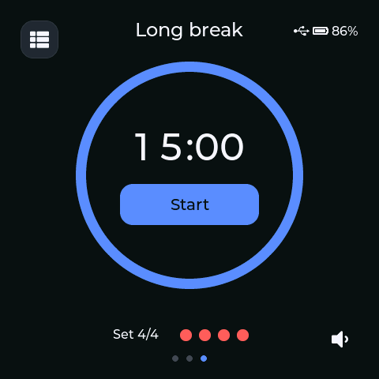 | 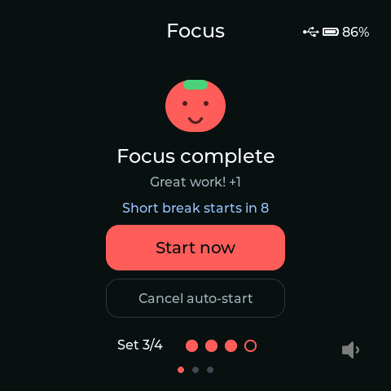 |

| Menu                      | Statistics                            | Settings                          |
| ------------------------- | ------------------------------------- | --------------------------------- |
| 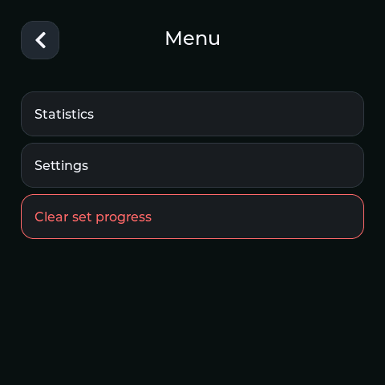 | 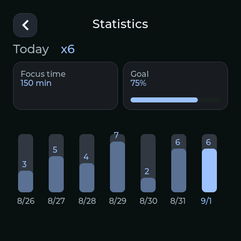 | 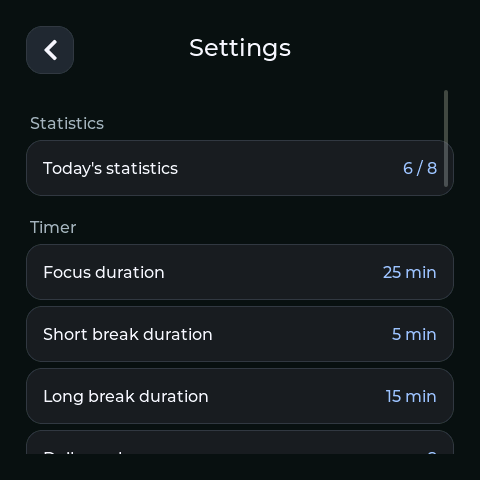 |

| Numeric Stepper                                 | Date & time                             | Reset Dialog                              |
| ----------------------------------------------- | --------------------------------------- | ----------------------------------------- |
| 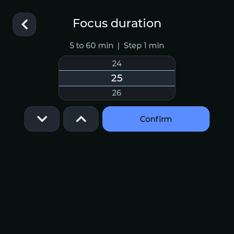 | 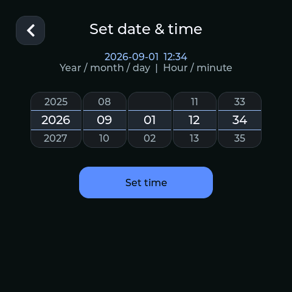 | 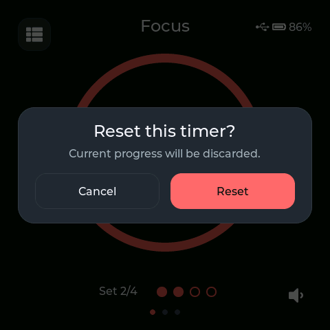 |

## 功能

- Focus、Short break 和 Long break 三种计时。
- 每四个 Pomodoro 组成一个 Pomodoro Set。
- 显示今日完成数、专注时长和最近七天统计。
- 保存最近 365 个 Statistics Day。
- 断电后恢复运行中或暂停中的计时。
- 手动设置本地日期和时间，不使用网络校时。
- 支持触摸、滑动切换模式、声音、亮度和自动旋转。
- 支持电池状态、低电量提示、自动调暗和熄屏。
- 可通过 USB 显示当前 Codex Workspace 的 Agent Status。

## 硬件

| 项目       | 设备                                 |
| ---------- | ------------------------------------ |
| 开发板     | Waveshare ESP32-C6-Touch-AMOLED-2.16 |
| 屏幕       | 480×480 SH8601 QSPI AMOLED           |
| 触摸       | CST9217                              |
| 实时时钟   | PCF85063，带后备电源                 |
| 姿态传感器 | QMI8658                              |
| 电源管理   | AXP2101                              |
| 音频       | ES8311                               |
| Flash      | 16 MB                                |
| 内存       | 512 KB HP SRAM，无 PSRAM             |
| 连接       | USB Serial/JTAG；固件不依赖 Wi-Fi    |

因为设备没有 PSRAM，界面只使用小型局部绘制缓冲，不使用完整帧缓冲。

硬件连接记录见 [docs/HARDWARE_CONNECTION_TEST.md](docs/HARDWARE_CONNECTION_TEST.md)。

## 使用设备

- 点按 `Start` 开始计时。
- 运行时可暂停；暂停后可继续或重置。
- 左右滑动可切换 Focus、Short break 和 Long break。
- 运行中切换模式前会要求确认，未完成的计时不会计入统计。
- 左上角菜单可进入 Statistics 和 Settings。
- 右下角按钮可静音或恢复声音。
- `KEY/+` 和 `BOOT/-` 调节音量。
- 短按 `PWR` 熄屏或唤醒，长按关机。

只有自然完成的 Focus 才算一个 Pomodoro。完成四个 Pomodoro 后进入 Long break。

## 开发环境

- ESP-IDF `>=5.5.2,<5.6`
- CMake 3.16 或更高版本
- 支持 C11 的编译器

先进入 ESP-IDF 5.5.x 环境：

```sh
. "$HOME/esp/esp-idf/export.sh"
```

## 运行测试

原生测试不需要连接设备：

```sh
cmake -S test -B build/host
cmake --build build/host --parallel
ctest --test-dir build/host --output-on-failure
```

## 构建固件

```sh
idf.py set-target esp32c6
idf.py build
```

## 烧录固件

先连接设备并找到串口：

```sh
ls /dev/cu.usbmodem*
```

使用仓库提供的脚本烧录：

```sh
tools/flash.sh -p /dev/cu.usbmodem11101
```

`tools/flash.sh` 会让 Agent Status broker 暂时释放 USB 串口，烧录结束后自动恢复。串口名称可能不同，也可以通过 `POMODORO_PORT` 指定。

不要运行 `erase-flash`。它会删除 Settings、当前计时和 Statistics。

## 导出 UI 截图

固件提供只读截图命令。先关闭占用串口的 monitor 或 Agent Status broker，再在 ESP-IDF 环境中运行：

```sh
python tools/export_screenshot.py \
  /dev/cu.usbmodem11101 \
  docs/esp32-screen.png
```

脚本会把设备当前显示缓冲保存为 480×480 PNG，不会修改设备状态。

## Agent Status（可选）

设备可以在主界面左下角显示所选 Codex Workspace 的状态：Error、Waiting、Working、Completed 或 Idle。状态通过 USB 发送，不会控制或修改 Pomodoro 计时。

插件源码位于 [plugins/pomodoro-agent-status](plugins/pomodoro-agent-status)。安装方法：

```sh
python3 ~/.codex/skills/.system/plugin-creator/scripts/create_basic_plugin.py \
  pomodoro-agent-status --with-marketplace
ditto plugins/pomodoro-agent-status "$HOME/plugins/pomodoro-agent-status"
codex plugin add pomodoro-agent-status@personal
```

打开新的 Codex thread，运行 `/hooks` 并信任插件 hooks，然后重启 Codex Desktop。在需要显示状态的 thread 中运行：

```text
$pomodoro-select
```

这会选择当前 Codex Workspace，并在需要时启动 broker。也可以手动以前台方式运行 broker：

```sh
node tools/pomodoro-agent-status-broker.mjs
```

如果安装过旧开发版，请先停止旧 broker，再删除旧状态目录。新版不会迁移这份数据：

```sh
rm -rf -- "${XDG_STATE_HOME:-$HOME/.local/state}/opencode/pomodoro-status"
```

## 目录

| 路径                            | 内容                                 |
| ------------------------------- | ------------------------------------ |
| `components/pomodoro_core`      | 计时、Pomodoro Set、统计和持久化格式 |
| `components/pomodoro_app`       | 应用状态和页面行为                   |
| `components/pomodoro_platform`  | 屏幕、触摸、RTC、音频、电源和 NVS    |
| `main`                          | ESP-IDF 程序入口和依赖               |
| `test`                          | 主机端自动化测试                     |
| `tools`                         | 烧录、截图和 Agent Status 工具       |
| `plugins/pomodoro-agent-status` | Codex Agent Status 插件源码          |
| `docs`                          | 产品说明、硬件记录和 ADR             |

领域术语见 [CONTEXT.md](CONTEXT.md)，架构决定见 [docs/adr](docs/adr)。
