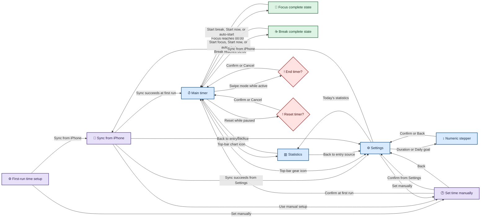

# Pomodoro 原型图描述文档

本文档用于指导 480×480 Waveshare ESP32-C6-Touch-AMOLED-2.16 的低保真/高保真原型绘制。所有真机 UI 文案使用英文；本文用中文解释页面结构与交互。

配套产品规则见 [POMODORO_APP_PROMPT.md](./POMODORO_APP_PROMPT.md)，领域术语见 [CONTEXT.md](../CONTEXT.md)。

## 1. 原型范围与画板规范

- 画板：480×480 px，正方形 AMOLED，外壳和屏幕可视区带圆角。
- 主题：固定深色主题，背景 `#0F1115`。
- 安全区：四周至少 24 px，顶部实体外壳不会进入 UI 画板。
- 最小触控区域：48×48 px；小图标或小圆点可视觉上更小，但不可交互元素不要伪装成按钮。
- 字体：Inter；倒计时数字使用 Space Mono。
- 主屏无滚动；Statistics、Numeric Stepper、首次设置页无滚动；只有 Settings 使用纵向滚动。
- 所有主页面使用统一顶部栏。子页面左侧显示 Back；主屏不显示 Back。
- 完成态是主屏中央内容的状态替换，不是独立浮层 Dialog。
- Dialog 仅用于放弃运行中计时和 Reset 确认。

## 2. 页面清单

| ID | 页面/状态 | 类型 | 主要入口 | 返回/出口 |
|---|---|---|---|---|
| P00 | First-run time setup | 全屏页面 | RTC 无效的首次开机 | 进入 P01 或 P02 |
| P01 | Sync from iPhone | 全屏页面 | P00；Settings 的 `Sync from iPhone` | 成功后进入来源目标；Back 返回来源 |
| P02 | Set time manually | 全屏页面 | P00；Settings 的 `Set manually`；P01 失败回退 | Confirm 后进入 Main 或返回 Settings |
| P10 | Main timer | 全屏页面 | 完成首次设置；从 Settings/Stats 返回；唤醒 | 进入 Stats、Settings、完成态或确认 Dialog |
| S10-A | Focus / Short break / Long break Ready | P10 状态 | 选择模式 | Start 进入 Running |
| S10-B | Running | P10 状态 | Start、Resume、自动开始 | Pause；计时完成；切换模式确认 |
| S10-C | Paused | P10 状态 | Running 中点击 Pause | Resume；Reset Dialog；切换模式确认 |
| S11 | Focus complete | P10 中央完成态 | Focus 到达 00:00 | Start break；或自动开始、Start now、Cancel auto-start |
| S12 | Break complete | P10 中央完成态 | Short/Long break 到达 00:00 | Start focus；或自动开始、Start now、Cancel auto-start |
| P20 | Statistics | 全屏页面 | Main 顶部图表图标；Settings 的 `Today's statistics` | 返回进入来源 |
| P30 | Settings | 可滚动全屏页面 | Main 顶部齿轮图标 | Back 返回 Main |
| P31 | Numeric stepper | 全屏页面模板 | 四个时长/目标设置项 | Confirm 或 Back 返回 Settings |
| D01 | End timer confirmation | 模态 Dialog | Running/Paused 中滑动切换模式 | Confirm 放弃并切换；Cancel 留在原状态 |
| D02 | Reset timer confirmation | 模态 Dialog | Paused 中点击 Reset | Confirm 回 Ready；Cancel 回 Paused |
| O01 | Volume overlay | 临时覆盖层 | 实体 `+` 或 `-` | 自动消失 |
| O02 | Battery low message | 临时提示层 | 电量首次低于约 15% | 自动消失，不中止计时 |
| E01 | RTC invalid state | 页面替换/阻断态 | 开机或运行中检测到 RTC 无效 | Sync 或手动设置时间 |

## 3. 页面导航图

导航图源文件：[pomodoro_prototype_01_flow_navigation.mmd](./diagrams/pomodoro_prototype_01_flow_navigation.mmd)。

## 4. 全局页面框架

### 4.1 顶部栏

高度建议 56–64 px，内容置于安全区内。

- 主屏左侧：模式图标 + `Focus`、`Short break` 或 `Long break`。
- 主屏右侧，从左到右：Battery、Sound、Statistics、Settings。
- Battery 为状态元素，不表现成普通按钮；Sound、Statistics、Settings 使用 48×48 px IconButton 触控区。
- 子页面左侧：Back IconButton + 页面标题。
- 子页面支持左边缘右滑返回；手势起点位于左侧 32 px，提交距离约 72 px。
- 完成态三秒自动开始倒计时期间，顶部交互暂时禁用。

### 4.2 颜色与状态

- Focus：`#FF5C5C`。
- Short break：`#4DD17A`。
- Long break：`#5B8CFF`。
- 页面背景：`#0F1115`；卡片：`#1A1F27`；抬升层：`#232A35`。
- 主文字：`#F5F7FA`；辅助文字：`#A7B0BE`；分隔线：`#303846`。
- 模式不能只依赖颜色区分，始终同时显示图标与文字。

### 4.3 AMOLED 保护在原型中的表达

- 可在交互说明中标注：运行中 2 分钟无操作降至用户亮度的 60%。
- Ready、Paused、等待操作的完成态：2 分钟变暗，5 分钟熄屏。
- 静态内容每分钟进行不易察觉的 ±2 px 像素偏移。
- 熄屏后第一次触摸只唤醒，不执行底层按钮。

## 5. P00 — First-run time setup

### 入口

- 设备首次开机且 RTC 未初始化。
- 开机检测到 RTC 无效。

### 页面结构（从上到下）

1. 顶部品牌/产品标题：`Pomodoro`，首次设置时不显示 Back。
2. 中央时钟插画或简洁时钟图标。
3. 标题：`Set date & time`。
4. 说明：`Time is required for daily statistics and timer recovery.`
5. 主按钮：`Sync from iPhone`，使用主强调色。
6. 次按钮：`Set manually`，使用描边或文本样式。
7. 辅助说明：`No account or internet connection is required.`

### 交互

- `Sync from iPhone` → P01。
- `Set manually` → P02。
- 不允许跳过；PWR 仍可熄屏/唤醒或关机。

## 6. P01 — Sync from iPhone

### 入口

- P00 的 `Sync from iPhone`。
- P30 Date & time 区块的 `Sync from iPhone`。

### 页面结构

1. 顶部栏：Back + `Sync from iPhone`。
2. 步骤标记：`1 of 2` / `2 of 2`，或使用简短状态文案。
3. 中央 QR Code，四周保留足够白色静区；二维码卡片可使用白底以确保扫描。
4. 热点名称，例如 `Pomodoro-7F2A`。
5. 状态说明：
   - `Scan this code with your iPhone.`
   - `The connection expires in 5:00.`
6. 连接后状态：`Connected — confirm Sync to Pomodoro on your iPhone.`
7. 次操作：`Set manually instead`。

### 状态变体

- Creating hotspot：小型进度指示器，不显示无法扫描的空二维码。
- Waiting for iPhone：显示二维码与倒数。
- iPhone connected：保持二维码但降低强调，突出确认说明。
- Syncing：显示 `Syncing time…`。
- Success：对勾 + `Time synced`，短暂停留后进入 Main 或返回 Settings。
- Timeout/Error：`Couldn't sync time` + `Try again` + `Set manually`。

### 返回规则

- 首次设置来源：同步成功进入 P10；Back 返回 P00。
- Settings 来源：成功或 Back 返回 P30。

## 7. P02 — Set time manually

### 入口

- P00、P01 回退、Settings Date & time 区块。

### 页面结构

1. 顶部栏：Back + `Set manually`。
2. 日期选择器：Year / Month / Day，轮式单选。
3. 时间选择器：Hour / Minute；使用 24 小时制以减少 AM/PM 歧义。
4. UTC offset 选择器，例如 `UTC−07:00`。
5. 说明：`Automatic daylight saving requires iPhone sync.`
6. 底部固定主按钮：`Confirm`。

### 交互

- Confirm 校验日期合法性后保存。
- 未确认时 Back 放弃修改。
- 首次设置 Confirm 后进入 Main；Settings 来源 Confirm 后返回 Settings。

## 8. P10 — Main timer

主屏只使用一个页面模板，按 Mode 和 Timer State 替换内容。禁止滚动。

### 8.1 共同布局

1. 顶部栏：Mode + Battery + Sound + Statistics + Settings。
2. 中央约 300 px CircularTimer。
3. 圆环内从上到下：状态文案、`MM:SS`、主按钮；Paused 时增加 Reset 文本操作。
4. 底部第一行：`Set N/4` + 4 个番茄轮廓标记。
5. 底部第二行：三个不可点击的模式分页点。

### 8.2 Mode 视觉变体

| Mode | 图标建议 | 状态色 | 默认时长 | 分页点位置 |
|---|---|---|---|---|
| Focus | 番茄或专注靶心 | 红 `#FF5C5C` | 25:00 | 第 1 点 |
| Short break | 小杯或叶片 | 绿 `#4DD17A` | 05:00 | 第 2 点 |
| Long break | 大杯或放松波纹 | 蓝 `#5B8CFF` | 15:00 | 第 3 点 |

### 8.3 Ready 状态

- 圆环内不显示状态描述文案。
- 圆环完整显示，倒计时为配置值。
- 主按钮：`Start`。
- 三种 Mode 未开始时的 `Start` 均使用 160×48 的紧凑按钮。
- 圆环和数字不响应点击；只有按钮可启动。
- 左右滑动直接切换模式，不出现确认。

### 8.4 Running 状态

- 圆环内不显示状态描述文案。
- 圆环从 12 点方向顺时针消退，彩色区域代表剩余时间。
- Space Mono 倒计时每秒更新。
- 主按钮：`Pause`。
- 三种 Mode 倒计时中的 `Pause` 均使用 160×48 的紧凑按钮，完整落在圆环内；不改变 Paused 状态的 Resume/Reset 布局。
- 左右滑动切换模式前显示 D01。
- 进入 Settings/Statistics 时计时继续；若后台完成，播放声音并自动返回完成态。

### 8.5 Paused 状态

- 不显示状态描述文案，并隐藏暂停时的倒计时。
- 圆环停止，可使用低幅度呼吸效果。
- 圆环内使用较小的 `Resume` 主按钮。
- 圆环内显示较小、低强调的 `Reset` 次操作；两个按钮作为一个整体垂直居中。
- 切换模式显示 D01；Reset 显示 D02。

### 8.6 模式滑动

- 固定顺序：Focus → Short break → Long break。
- 向左进入下一项，向右返回上一项。
- 不首尾循环；边界处使用轻微回弹或短位移反馈。
- 由于无 PSRAM，达到手势阈值后使用约 120 ms 的黑色遮罩淡入/淡出，不改变根 screen 的透明度，也不绘制全屏跟手动画。

## 9. S11 — Focus complete

此状态替换 P10 中央 CircularTimer，保留顶部栏和底部 Set Progress。

### UI 元素

1. 小型微笑番茄插画。
2. 少量彩带；约 1 秒停止。
3. 标题：`Focus complete`。
4. 正文：`Great work! +1`，旁边使用番茄图标而非 Emoji 字符。
5. 若首次达到 Daily Goal，追加 `Daily goal reached!`。
6. Set Progress 已完成一项；第四个完成后显示 `Set 4/4`。

### 自动开始开启

- 显示：`Short break starts in 3` 或 `Long break starts in 3`。
- 主按钮：`Start now`。
- 次操作：`Cancel auto-start`。
- 取消只影响本次，进入下一 Mode 的 Ready 状态。
- 三秒内其他导航与模式手势禁用。

### 自动开始关闭

- 主按钮：`Start break`（由应用按 Set 进度决定进入 Short break 或 Long break）。普通完成状态不显示 `Not now`；仅自动开始倒计时时显示 `Cancel auto-start`。
- 页面保持到用户操作；无操作 2 分钟变暗、5 分钟熄屏。

## 10. S12 — Break complete

同样替换主屏中央区域。

### UI 元素

1. 带蒸汽的扁平杯子插画。
2. 标题：`Break over`。
3. 正文：`Ready for another focus?`。
4. Long break 完成后 Set Progress 变为 `0/4`。

### 自动开始开启

- `Focus starts in 3`。
- `Start now` + `Cancel auto-start`。

### 自动开始关闭

- 仅显示 `Start focus`。

## 11. P20 — Statistics

### 入口

- Main 顶部 Statistics 图标。
- Settings 的 `Today's statistics`。

### 页面结构

1. 顶部栏：Back + `Statistics`。
2. 今日主指标：小标签 `Today` + 大数字 `× N`，使用番茄图标。
3. 两张并排 Card：
   - `Focus time`：例如 `3h 20m`。
   - `Goal`：例如 `125%`；进度视觉填充最多 100%。
4. 最近七日柱状图：占页面下半部。
5. 横轴使用 `M/D`，从最早日期到今日；今日在最右且使用高亮。
6. 每根柱顶显示完成番茄数。
7. 纵轴至少覆盖当前 Daily Goal，并可按最近七日最大值扩大。

### 空状态与异常

- 今日为 0：Cards 显示 `0m` 和 `0%`，图表仍显示最近七日。
- RTC 无效：隐藏图表，显示时钟图标、`Set date & time to view statistics` 和进入时间设置的按钮。
- 返回目标取决于入口来源，不固定跳回 Main。

## 12. P30 — Settings

### 入口

- Main 顶部 Settings 图标。

### 页面结构

- 固定顶部栏：Back + `Settings`。
- 内容区允许纵向滚动；滚动条可极弱显示或自动隐藏。
- 行高至少 56 px，Switch 行整行可点击；危险操作不存在。

### 区块与行

#### Statistics

- `Today's statistics`：右侧 Chevron，进入 P20。

#### Timer

- `Focus duration` — 右侧当前值，例如 `25 min` → P31。
- `Short break duration` — `5 min` → P31。
- `Long break duration` — `15 min` → P31。
- `Daily goal` — `8` → P31。

#### Automation

- `Auto-start breaks` — Switch，默认 On。
- `Auto-start focus` — Switch，默认 Off。

#### Sound

- `Sound` — Switch，与顶部快捷键同步，默认 On。
- `Volume` — 只读值，例如 `3/5`。
- 辅助文案：`Use the side buttons to adjust volume.`

#### Display

- `Brightness` — Slider，10%–100%，步进 5%，默认 70%。
- 拖动实时预览，松手保存。

#### Date & time

- 当前本地日期时间，例如 `Aug 15, 2026 · 14:35`。
- `Time zone` — 例如 `America/Edmonton` 或固定 UTC offset。
- `Sync from iPhone` → P01。
- `Set manually` → P02。
- 若 DST 规则即将过期，显示 StatusBadge：`Time zone rules need sync`。

#### Power

- `Battery` — 近似百分比。
- `Charging` / `On battery` / `USB power` 状态。

### 保存规则

- Switch 立即保存。
- Brightness 松手保存。
- NumericStepper、日期和时间只有 Confirm 后保存。
- Back 不撤销已经保存的设置。

## 13. P31 — Numeric stepper

一个页面模板复用于四种设置。

### 入口与约束

| 来源 | 标题 | 范围 | 步进 | 单位 |
|---|---|---:|---:|---|
| Focus duration | `Focus duration` | 5–60 | 1 | min |
| Short break duration | `Short break duration` | 1–30 | 1 | min |
| Long break duration | `Long break duration` | 5–60 | 1 | min |
| Daily goal | `Daily goal` | 1–16 | 1 | Pomodoros |

### 页面结构

1. 顶部栏：Back + 动态标题。
2. 中央上箭头 IconButton。
3. 三行滚轮：上一值（弱）、当前值（大号高亮）、下一值（弱）。
4. 中央下箭头 IconButton。
5. 单位标签。
6. 底部主按钮：`Confirm`。

### 交互

- 上下滑动滚轮或点击箭头调整。
- 到达边界后不循环，可给轻微边界反馈。
- Confirm 保存并返回 Settings。
- Back 放弃未确认值，不显示额外 Dialog。
- 修改当前模式的时长不影响正在运行或暂停的计时。

## 14. D01 — End timer confirmation

### 入口

- Running 或 Paused 时通过左右滑动请求切换到其他 Mode。

### Dialog 内容

- 标题：`End this timer?`
- 正文：`Current progress will be discarded.`
- 取消按钮：`Cancel`。
- 确认按钮：`End and switch`，使用警示色但不使用全屏红色。

### 行为

- Confirm：产生 Aborted Timer，切换到目标 Mode 的 Ready 状态；不增加 Pomodoro 或 Set Progress。
- Cancel：恢复原状态和剩余时间。
- 点击遮罩等同 Cancel；实体音量键仍可调音量。

## 15. D02 — Reset timer confirmation

### 入口

- Paused 状态点击 `Reset`。

### Dialog 内容

- 标题：`Reset this timer?`
- 正文：`Current progress will be discarded.`
- `Cancel` + `Reset`。

### 行为

- Confirm：回到当前 Mode 的 Ready 状态和完整配置时长。
- Cancel：回到 Paused。

## 16. O01 — Volume overlay

### 入口

- 正常运行时按 `+/KEY` 或 `BOOT/-`。

### UI 元素

- 屏幕上方或中央偏上显示小型 Raised Surface。
- 扬声器图标 + 5 段音量条 + 数字，例如 `3/5`。
- 音量 0 显示静音图标，并同步顶部 Sound 状态。
- 约 1.5 秒无继续按键后淡出。
- 覆盖层不暂停计时、不截断完成态声音之外的流程。

## 17. O02 — Battery low message

- 电量首次低于约 15% 时，从顶部栏下方显示轻量提示：`Battery low`。
- Battery 图标切换为警示色。
- 不使用阻断 Dialog，不停止或暂停计时。
- 同一低电量周期只提示一次，避免重复干扰。

## 18. E01 — RTC invalid state

### 开机时

- 直接使用 P00，不允许进入 Main。

### 运行中

- 当前 Timer 继续使用单调时钟。
- 页面顶部显示非阻断 StatusBadge：`Date & time unavailable`。
- 完成结果进入 Pending Statistics。
- Statistics 使用异常空状态。
- 用户进入时间设置并恢复 RTC 后，待处理记录归入恢复时的 Statistics Day。

## 19. 原型连线与交互检查清单

- P00 的两个入口都能最终到达 Main，且没有 Skip。
- P01/P02 从首次设置与 Settings 进入时拥有不同返回目标。
- Main 的 Statistics 与 Settings IconButton 都可操作。
- Stats Back 能返回正确来源。
- 四个 NumericStepper 共享模板但范围正确。
- Running/Paused 的模式滑动必须先经过 D01。
- Ready 的模式滑动不显示 Dialog。
- Paused 才出现 Reset，且必须经过 D02。
- 模式分页点不可点击。
- 自动开始三秒期间禁用顶部导航和模式滑动。
- `Cancel auto-start` 不改变 Settings 中的开关。
- 第四个 Focus 完成显示 4/4；Long break 完成显示 0/4。
- 在 4/4 跳过 Long break 并开始 Focus 时，开始瞬间显示 0/4。
- Settings/Stats 打开时 Timer 继续运行，完成后自动返回 Main 完成态。
- 实体音量键在所有非启动阶段都可调节音量；PWR 短按只控制屏幕睡眠/唤醒。
- 所有页面覆盖变暗、熄屏、首次触摸只唤醒和 AMOLED 像素偏移说明。

## 20. 建议输出的原型画板

为了覆盖所有关键交互，设计工具中至少建立以下画板：

1. First-run time setup。
2. iPhone sync — waiting。
3. iPhone sync — success/error（可用组件变体）。
4. Manual date/time。
5. Focus — Ready。
6. Focus — Running。
7. Focus — Paused。
8. Short break — Running。
9. Long break — Running。
10. Focus complete — auto-start on。
11. Focus complete — auto-start off。
12. Break complete。
13. Daily goal reached 变体。
14. Statistics — populated。
15. Statistics — RTC invalid/empty。
16. Settings — top section。
17. Settings — lower section。
18. Numeric stepper — duration。
19. Numeric stepper — Daily goal。
20. End timer Dialog。
21. Reset Dialog。
22. Volume overlay。
23. Battery low 状态。

原型应优先验证 480×480 真机可读性、顶部栏拥挤程度、CircularTimer 内按钮触控面积、Settings 滚动手感以及无 PSRAM 条件下的转场简化效果。
